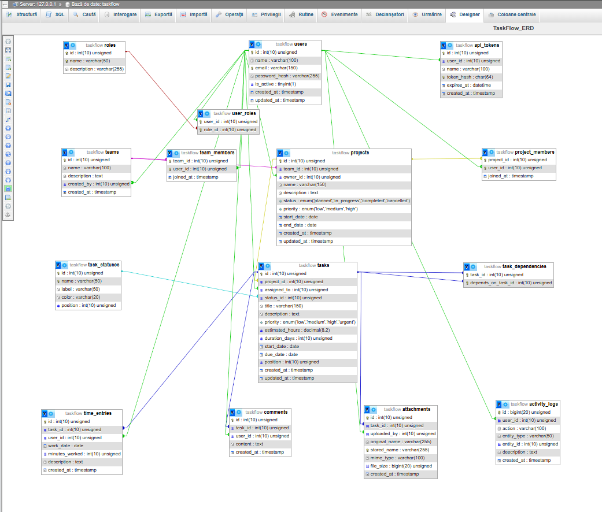

# TaskFlow - Documentarea bazei de date

## 1. Informatii generale

- Autor: Vicicu Viorel
- Grupa: IT2501
- Disciplina: Programare Web II
- Varianta: 15
- Proiect: TaskFlow
- Tema: Management de proiecte si pontaj
- SGBD: MySQL / MariaDB
- Baza de date: taskflow
- Motor de stocare: InnoDB
- Codificare: utf8mb4_unicode_ci
- Numar de tabele: 15
- Etapa: Commit 6

## 2. Scopul bazei de date

Am proiectat o baza de date relationala pentru
aplicatia web TaskFlow, destinata gestionarii
proiectelor, echipelor, sarcinilor si timpului
de lucru.

Am organizat informatiile in 15 tabele pentru
a reduce redundanta si a asigura integritatea
datelor.

## 3. Structura bazei de date

| Tabel | Descriere |
|---|---|
| users | Utilizatorii aplicatiei |
| roles | Rolurile utilizatorilor |
| user_roles | Asocierea utilizatorilor cu rolurile |
| teams | Echipele de lucru |
| team_members | Membrii echipelor |
| projects | Proiectele create |
| project_members | Participantii la proiecte |
| task_statuses | Starile sarcinilor Kanban |
| tasks | Sarcinile proiectelor |
| task_dependencies | Dependentele dintre sarcini |
| time_entries | Evidenta timpului de lucru |
| comments | Comentariile sarcinilor |
| attachments | Fisierele atasate |
| api_tokens | Tokenurile de acces API |
| activity_logs | Istoricul activitatilor |

## 4. Relatiile dintre tabele

Am stabilit urmatoarele relatii:

- users - roles: Many-to-Many.
- users - teams: Many-to-Many.
- users - projects: Many-to-Many.
- teams - projects: One-to-Many.
- projects - tasks: One-to-Many.
- task_statuses - tasks: One-to-Many.
- tasks - task_dependencies: relatii intre sarcini.
- tasks - time_entries: One-to-Many.
- tasks - comments: One-to-Many.
- tasks - attachments: One-to-Many.
- users - api_tokens: One-to-Many.
- users - activity_logs: One-to-Many.

Am utilizat tabele intermediare pentru
implementarea relatiilor Many-to-Many.

## 5. Integritatea datelor

Pentru asigurarea integritatii datelor am utilizat:

- PRIMARY KEY - identificarea unica a inregistrarilor.
- FOREIGN KEY - realizarea relatiilor dintre tabele.
- UNIQUE - prevenirea valorilor duplicate.
- NOT NULL - completarea campurilor obligatorii.
- DEFAULT - stabilirea valorilor implicite.
- CHECK - verificarea anumitor conditii.
- INDEX - optimizarea interogarilor.
- AUTO_INCREMENT - generarea identificatorilor.

## 6. Securitatea bazei de date

Am pregatit structura necesara pentru:

- Stocarea parolelor sub forma de hash.
- Gestionarea rolurilor utilizatorilor.
- Stocarea securizata a tokenurilor API.
- Inregistrarea activitatilor utilizatorilor.
- Utilizarea ulterioara a conexiunii PDO.
- Prevenirea injectiilor SQL prin instructiuni pregatite.

Mecanismele de autentificare si autorizare
vor fi implementate in etapele urmatoare.

## 7. Instalarea bazei de date

Pentru instalarea bazei de date am realizat
urmatorii pasi:

1. Am pornit Apache si MySQL din XAMPP.
2. Am accesat phpMyAdmin.
3. Am importat fisierul database/schema.sql.
4. Am creat baza de date taskflow.
5. Am verificat existenta celor 15 tabele.
6. Am verificat structura tabelelor.
7. Am deschis instrumentul Designer.
8. Am organizat tabelele si relatiile.
9. Am salvat schema TaskFlow_ERD.

## 8. Schema relationala ERD

Am utilizat instrumentul Designer din phpMyAdmin
pentru reprezentarea grafica a bazei de date.

Am organizat tabelele in patru categorii:

1. Utilizatori si securitate.
2. Echipe si proiecte.
3. Gestionarea sarcinilor.
4. Pontaj si activitati.

Denumirea schemei salvate: TaskFlow_ERD.



## 9. Verificarea bazei de date

Am verificat numarul tabelelor prin interogarea:

```sql
SELECT COUNT(*) AS total_tabele
FROM information_schema.tables
WHERE table_schema = 'taskflow'
AND table_type = 'BASE TABLE';
```

Rezultatul obtinut: 15 tabele.

Am executat si interogarile:

```sql
DESCRIBE projects;
SHOW CREATE TABLE tasks;
```

## 10. Concluzie

In cadrul acestei etape am proiectat si creat
baza de date relationala pentru aplicatia TaskFlow.

Am definit cele 15 tabele, cheile primare,
cheile straine si relatiile dintre entitati.

Am realizat schema relationala utilizand
instrumentul Designer din phpMyAdmin.

Prin aceasta etapa am pregatit structura
necesara pentru implementarea autentificarii,
operatiilor CRUD, sistemului Kanban, pontajului,
metodei CPM si rapoartelor.

In etapa urmatoare voi implementa migrarile
si datele demonstrative ale aplicatiei.
